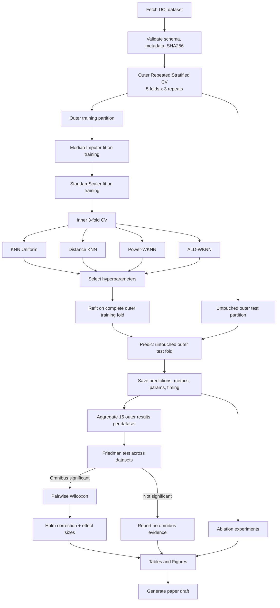
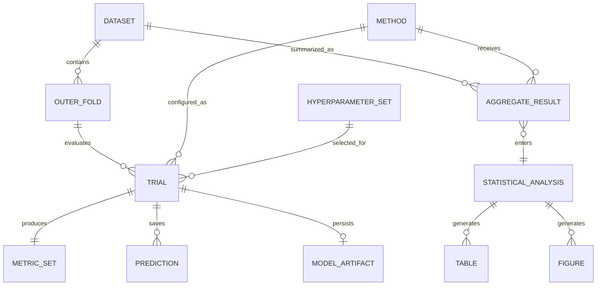

# PROJECT_SPEC.md — ALD-WKNN: Adaptive Local-Density Distance Weighting for K-Nearest Neighbors

## Ringkasan Eksekutif

Dokumen ini adalah spesifikasi proyek **siap dieksekusi oleh agentic AI pada Ubuntu Server** untuk menghasilkan eksperimen yang reproducible dan draf paper tugas kuliah mengenai modifikasi sederhana K-Nearest Neighbors. Metode kerja diberi nama **ALD-WKNN — Adaptive Local-Density Distance-Weighted K-Nearest Neighbors**.

**Status kebaruan: belum terverifikasi dan tidak boleh diklaim sebagai metode baru.** Penelusuran literatur hingga **21 Oktober 2026** menemukan bahwa ide besar “KNN + local density + adaptive/weighted neighborhood” sudah memiliki banyak pendahulu. Di antaranya adalah DBANN yang menggunakan kepadatan lokal/global untuk mengubah distance metric pada masalah imbalance/overlap, locally adaptive KNN, locally informed weighted KNN, serta metode KNN baru yang menggunakan informasi lokal dalam pembobotan. citeturn19view3turn23search0turn25view2 Bahkan terdapat publikasi ACM tahun 2025 yang menyebut *dynamic distance-weighted KNN* dengan komputasi local density dan uncertainty, sehingga pencarian formula-level lebih lanjut wajib dilakukan sebelum menggunakan kata *novel*. citeturn24search27

Kontribusi yang **aman untuk tugas kuliah** adalah merancang dan menguji formulasi yang sangat sederhana:

\[
\boxed{
w_i(x)=
\left(d(x,x_i)+\epsilon\right)^{-p}
\exp\left[
-\alpha
\min\left(
c,
\left|
\log
\frac{\rho_q(x)+\epsilon}
{\rho_q(x_i)+\epsilon}
\right|
\right)
\right]
}
\]

Bobot tersebut menggabungkan dua gagasan:

1. **kedekatan geometris** melalui inverse-distance weighting; dan
2. **kesesuaian kepadatan lokal** (*local-density compatibility*) antara query \(x\) dan neighbor \(x_i\).

Formulasi ini **tidak sekadar memberi bobot lebih tinggi pada titik yang padat**, karena strategi tersebut berisiko semakin menguatkan kelas mayoritas. Sebaliknya, neighbor diberi penalti ketika berada pada rezim kepadatan lokal yang sangat berbeda dari query.

Pencarian yang dilakukan menemukan metode-metode yang konseptualnya dekat, tetapi **belum cukup untuk membuktikan bahwa clipped log-density-ratio compatibility penalty di atas belum pernah dipublikasikan**. Oleh karena itu, dokumen ini menggunakan istilah **candidate formulation / proposed experimental formulation**, bukan *novel algorithm*. Temuan negatif dari pencarian literatur bukan bukti kebaruan.

Eksperimen utama menggunakan delapan dataset numerik UCI dengan ukuran kecil sampai sedang: Iris, Wine, Seeds, Glass Identification, Sonar, Ionosphere, Breast Cancer Wisconsin Diagnostic, dan Banknote Authentication. Dataset tersebut memberikan variasi jumlah fitur, jumlah kelas, ukuran sampel, dan tingkat kesulitan; UCI mengonfirmasi karakteristik utama dataset, misalnya Iris memiliki 150 observasi dan 4 fitur, WDBC 569 × 30, Ionosphere 351 × 34, Sonar 208 × 60, Wine 178 × 13, Glass 214 × 9, dan Banknote 1.372 × 4. citeturn20search0turn20search1turn20search2turn21search0turn22view0turn22view1turn22view2

Evaluasi wajib menggunakan **nested cross-validation**, sehingga pemilihan \(k,q,p,\alpha\) tidak menyentuh outer test fold. Unit inferensi statistik adalah **dataset**, bukan fold CV. Empat metode utama dibandingkan: Uniform KNN, standard distance-weighted KNN, power distance-weighted KNN, dan ALD-WKNN. Setelah skor setiap metode diringkas menjadi satu nilai per dataset, digunakan **Friedman test**, dilanjutkan **pairwise Wilcoxon signed-rank + Holm correction** hanya apabila omnibus test memberikan alasan untuk post-hoc comparison. Literatur metodologi Elsevier dan Springer mendukung penggunaan prosedur non-parametrik untuk multiple classifier comparisons dan mengingatkan pentingnya penanganan multiple comparisons. citeturn26search0turn18search3

**Kriteria keberhasilan proyek bukan “ALD-WKNN harus menang”.** Proyek dianggap berhasil apabila:

| Kriteria | Kondisi lulus |
|---|---|
| Reproducibility | Menjalankan seed dan environment yang sama menghasilkan skor identik/toleransi numerik |
| No leakage | Imputation, scaling, density calculation, dan tuning hanya menggunakan training portion yang sah |
| Benchmark | Seluruh baseline dan ALD-WKNN selesai pada seluruh dataset |
| Ablation | Distance-only, density-only, unclipped, dan full ALD tersedia |
| Statistik | Friedman, Holm-adjusted Wilcoxon, effect sizes, dan mean ranks tersedia |
| Transparency | Hasil negatif tetap dilaporkan |
| Novelty claim | Tidak ada klaim novelty tanpa verifikasi tambahan |
| Artifacts | Predictions, fold metrics, parameters, logs, environment, figures, dan tables tersimpan |
| Paper | `paper/paper.md` dan/atau `paper/paper.pdf` dapat dibuat otomatis |

Repository yang harus dibuat agent:

```text
ald-wknn-paper/
├── README.md
├── PROJECT_SPEC.md
├── requirements.txt
├── environment.yml
├── Dockerfile
├── Makefile
├── .gitignore
├── configs/
│   ├── experiment.yaml
│   └── smoke.yaml
├── src/
│   └── aldwknn/
│       ├── __init__.py
│       ├── model.py
│       ├── data.py
│       ├── cv.py
│       ├── metrics.py
│       ├── statistics.py
│       ├── reporting.py
│       └── utils.py
├── scripts/
│   ├── download_data.py
│   ├── run_experiments.py
│   ├── run_ablation.py
│   ├── analyze_statistics.py
│   ├── make_tables.py
│   ├── make_figures.py
│   ├── build_paper.py
│   ├── validate_reproducibility.py
│   └── run_all.sh
├── tests/
│   ├── test_model.py
│   ├── test_density.py
│   ├── test_zero_distance.py
│   ├── test_no_leakage.py
│   ├── test_reproducibility.py
│   └── test_statistics.py
├── data/
│   ├── raw/
│   ├── metadata/
│   └── hashes/
├── artifacts/
│   ├── runs/
│   ├── models/
│   ├── tables/
│   ├── figures/
│   ├── statistics/
│   ├── logs/
│   └── environment/
└── paper/
    ├── paper.md
    ├── paper.tex
    ├── references.bib
    └── generated/
```

## Paper Front Matter

**Title**

Judul utama yang direkomendasikan:

> **Adaptive Local-Density Distance Weighting for K-Nearest Neighbors: A Reproducible Multi-Dataset Evaluation**

Judul alternatif yang lebih konservatif:

> **Evaluating Query–Neighbor Local-Density Compatibility in Distance-Weighted K-Nearest Neighbors**

Versi Bahasa Indonesia:

> **Evaluasi Pembobotan Jarak Adaptif Berbasis Kesesuaian Kepadatan Lokal pada K-Nearest Neighbors**

Hindari judul seperti *“A Novel ALD-WKNN Algorithm”*, *“An Improved KNN with Superior Performance”*, atau *“State-of-the-Art KNN”*. Literatur sudah menunjukkan bahwa adaptive KNN, density-aware KNN, dan sophisticated weighted KNN telah banyak dikembangkan. citeturn19view3turn23search0turn25view2

**Keywords**

`K-Nearest Neighbors; Weighted KNN; Local Density; Adaptive Weighting; Density Compatibility; Classification; Nested Cross-Validation; Statistical Comparison`

**Abstract — template sebelum eksperimen**

> **Abstract**
>
> K-Nearest Neighbors (KNN) is a simple instance-based classification method whose predictions depend strongly on neighborhood selection and the weighting assigned to neighboring observations. Distance-weighted KNN gives greater influence to observations located closer to a query but does not explicitly account for whether the query and its neighbors belong to locally comparable density regimes. Previous studies have already explored adaptive, density-based, and locally informed KNN classifiers; therefore, combining KNN with local-density information cannot in itself be considered novel. This study evaluates a simple experimental formulation, Adaptive Local-Density Distance-Weighted KNN (ALD-WKNN), in which conventional inverse-distance weights are multiplied by a bounded compatibility term derived from the log-ratio between the local-density proxies of the query and each neighbor. The method is evaluated against uniform KNN, conventional distance-weighted KNN, and power distance-weighted KNN using eight public tabular classification datasets. Model selection is performed by nested cross-validation, while ablation experiments isolate the effects of distance weighting, density compatibility, and clipping. Macro F1-score is used as the primary evaluation metric, supplemented by balanced accuracy, accuracy, macro precision, macro recall, and computational time. Cross-dataset comparisons are analyzed using the Friedman test followed, where justified, by Wilcoxon signed-rank comparisons with Holm correction. **[Replace this sentence with empirical results only after all experiments have completed.]** The study is intended as a reproducible empirical investigation of a minimal KNN modification rather than an a priori claim of algorithmic novelty.

Agent **dilarang** mengisi kalimat hasil dengan angka sebelum `artifacts/runs/.../metrics_outer.csv` tersedia.

## Introduction

K-Nearest Neighbors merupakan classifier non-parametrik berbasis instance yang menentukan label berdasarkan observasi training yang dekat terhadap query. Fondasi nearest-neighbor classification sudah dibahas oleh Cover dan Hart dalam IEEE Transactions on Information Theory, sementara distance-weighted KNN klasik diperkenalkan oleh Dudani untuk membuat kontribusi tetangga bergantung pada jaraknya terhadap query. citeturn18search2turn2search0

Weighted nearest-neighbor kemudian berkembang dalam banyak arah. Fuzzy KNN, misalnya, menggunakan fuzzy class memberships, sementara berbagai penelitian yang lebih baru mengembangkan local adaptation, local means, neighborhood information, proximity information, class imbalance handling, dan density-aware mechanisms. citeturn8search3turn16search0turn19view3turn25view2

Hal tersebut sangat penting terhadap framing penelitian ini. **Local density bukan ide baru untuk KNN.** Yuan et al. mengusulkan DBANN yang membagi data berdasarkan density dan menyesuaikan distance metric menggunakan distribusi lokal dan global untuk menghadapi class overlap dan imbalance; eksperimen mereka mencakup 16 synthetic dan 41 real-world datasets. citeturn19view3 Abdalla dan Amer pada 2025 juga memperkenalkan *locally informed weighted k-nearest neighbor* untuk classification, sedangkan studi Springer tahun 2025 tentang PR-kNN/WPR-kNN mengintegrasikan local consistency/proximity information dan beberapa weighting schemes serta mengujinya pada puluhan dataset. citeturn23search0turn25view2

Karena itu, masalah penelitian ini bukan:

> “Belum pernah ada KNN yang menggunakan local density.”

Pernyataan tersebut salah atau setidaknya tidak dapat dipertahankan berdasarkan literatur yang ditemukan. citeturn19view3turn24search1

Masalah yang diuji lebih sempit:

> **Apakah penalti sederhana berbasis ketidakcocokan kepadatan lokal antara query dan neighbor dapat memberikan perilaku klasifikasi yang lebih baik atau lebih stabil dibandingkan distance weighting saja, ketika dievaluasi secara fair melalui nested cross-validation pada beragam dataset tabular kecil?**

**Research questions**

`RQ1` — Apakah ALD-WKNN menghasilkan Macro F1 yang berbeda secara konsisten dibandingkan KNN uniform dan conventional distance-weighted KNN?

`RQ2` — Apakah komponen *density compatibility* memberikan kontribusi setelah efek distance weighting dipisahkan melalui ablation?

`RQ3` — Apakah clipping terhadap density mismatch membantu stabilitas dibandingkan formulasi tanpa clipping?

`RQ4` — Pada karakteristik dataset apa ALD-WKNN membantu, netral, atau justru merugikan?

`RQ5` — Berapa tambahan waktu komputasi yang dibutuhkan untuk mendapatkan local-density information?

**Hipotesis yang akan diuji**

Untuk cross-dataset comparison:

\[
H_0:
R_{\text{KNN}}
=
R_{\text{DWKNN}}
=
R_{\text{PWKNN}}
=
R_{\text{ALD}}
\]

dengan \(R\) menyatakan expected/ranked performance lintas dataset dalam rancangan Friedman.

Hipotesis alternatif:

\[
H_1:
\exists i,j:R_i\neq R_j
\]

Tidak dibuat hipotesis bahwa ALD-WKNN *harus* memiliki skor lebih tinggi.

**Kontribusi yang diperbolehkan bila eksperimen berhasil**

Kontribusi paper dapat ditulis sebagai:

> “This work evaluates a simple query–neighbor density-compatibility weighting formulation and systematically isolates its components through nested cross-validation and ablation across heterogeneous tabular datasets.”

Bukan:

> “This paper presents the first density-aware KNN.”

**Novelty gate sebelum submission**

Agent harus mencari exact/near-exact formula berikut pada IEEE Xplore, ACM DL, ScienceDirect, SpringerLink, dan—bila mahasiswa memiliki akses—Scopus:

```text
"local density" AND "weighted k-nearest neighbor" classification
"density ratio" AND KNN AND classification
"query density" AND "neighbor density" AND KNN
"density compatibility" AND nearest neighbor
"log density ratio" AND nearest neighbor classification
"adaptive distance weighted KNN" AND density
"local density aware" AND KNN
"density-based adaptive k nearest neighbor"
```

Tanggal pencarian harus dicatat di:

```text
artifacts/environment/literature_search.md
```

dengan fields:

```text
Search date:
Database:
Query:
Number of results screened:
Relevant papers:
Potential formula overlap:
Decision:
```

Jika agent menemukan formula ekuivalen:

\[
d^{-p}\exp[-\alpha |\log(\rho_x/\rho_i)|]
\]

atau transformasi monoton yang secara substansial sama, maka paper harus diubah dari “method development” menjadi **replication/extension study**, tanpa menyembunyikan prior work.

## Related Work / State of the Art

Penelusuran primer menunjukkan evolusi dari nearest-neighbor dasar menuju distance weighting, fuzzy weighting, locally adaptive classification, density-based distance adaptation, dan locally informed weighting. Cover dan Hart memberikan fondasi nearest-neighbor classification di IEEE; Dudani memperkenalkan distance-weighted rule; Keller et al. memperluasnya melalui fuzzy membership. citeturn18search2turn2search0turn8search3

Yang paling relevan terhadap potensi originalitas penelitian ini adalah penelitian modern. Pan et al. mengembangkan locally adaptive KNN berbasis struktur kelas lokal; Yuan et al. mengembangkan density-based adaptive KNN untuk class overlap dan imbalance; Abdalla dan Amer mengembangkan locally informed weighted KNN; dan Amer et al. mengembangkan proximity-informed/weighted KNN serta mengujinya pada 52 datasets. citeturn16search0turn19view3turn23search0turn25view2

Selain itu, Ding et al. menggunakan weighted KNN untuk membangun local-density measure dalam density-peaks clustering. Konteksnya clustering, bukan supervised KNN classification, tetapi publikasi tersebut memperkuat fakta bahwa kombinasi “local density + weighted KNN” bukan konsep yang dapat diklaim baru secara umum. citeturn23search3turn24search3

Sebuah artikel ACM tahun 2025 dengan judul *A Dynamic Distance-Weighted KNN Model for Customized...* juga terdeteksi menggunakan local density dan uncertainty; full-text metadata artikel tersebut perlu diperiksa manual karena hasil akses dalam penelitian ini tidak cukup untuk menentukan kedekatan formulanya terhadap ALD-WKNN. citeturn24search27 Ini harus menjadi **mandatory novelty-check item**.

**State-of-the-art matrix**

| Referensi | Portal terverifikasi | Ide utama | Kedekatan dengan ALD-WKNN | Implikasi |
|---|---|---|---|---|
| Cover & Hart, 1967 | IEEE Xplore | Nearest-neighbor classification | Fondasi | Bukan novelty |
| Dudani, 1976 | IEEE Xplore | Distance-weighted KNN | Sangat relevan untuk faktor \(d^{-p}\) | Distance weighting bukan novelty |
| Keller et al., 1985 | IEEE Xplore | Fuzzy KNN | Weighted classification | Weighted voting bukan novelty |
| Macleod et al., 1987 | IEEE Xplore | Re-examination distance-weighted KNN | Benchmark konseptual | Distance weighting telah lama dianalisis |
| Pan et al., 2020 | ScienceDirect / Elsevier | Locally adaptive KNN | Adaptivitas lokal | “Adaptive KNN” bukan novelty |
| Yuan et al., 2021 | SpringerLink | Density-based adaptive KNN / DBANN | **Sangat dekat secara konsep** | “Density-aware KNN” bukan novelty |
| Ding et al., 2024 | ScienceDirect / ACM metadata | Weighted-KNN local density untuk clustering | Density construction mirip, task berbeda | Density + KNN bukan novelty |
| Abdalla & Amer, 2025 | ScienceDirect / ACM metadata | Locally informed weighted KNN | **Sangat dekat** | Local information + weights bukan novelty |
| Amer et al., 2025 | SpringerLink | PR-kNN/EPR-kNN/WPR-kNN | Local consistency + weighting | Strong modern comparator concept |
| Dynamic DW-KNN, 2025 | ACM DL | Dynamic DW-KNN, density + uncertainty | **Must inspect** | Formula-level novelty belum aman |

Sumber publisher mengonfirmasi bahwa DBANN menyesuaikan metric berdasarkan distribusi lokal/global dan bahwa WPRkNN menggunakan local consistency serta multiple weighting schemes. citeturn19view3turn25view2

**Research gap yang defensibel**

Research gap untuk tugas ini harus ditulis sebagai:

> Existing studies already establish distance-weighted, locally adaptive, density-based, and locally informed variants of KNN. Within the literature inspected for this coursework, a narrower question remains worth empirically testing: whether a **minimal label-independent query-to-neighbor density-compatibility penalty**, expressed as a bounded log-ratio of local density proxies and multiplied directly by inverse-distance weighting, yields measurable benefits over simpler distance weighting under a leakage-controlled nested-CV protocol. This is treated as a **candidate formula-level distinction**, not as established algorithmic novelty.

Frasa “within the literature inspected” penting karena hasil pencarian literatur tidak menjamin exhaustive coverage.

**Mengapa formula yang diusulkan berbeda dari density reward sederhana**

Formula awal seperti

\[
w_i \propto \frac{\rho_i^\alpha}{d_i}
\]

memberikan bobot lebih tinggi kepada neighbor dari area yang padat. Masalah konseptualnya adalah area padat sering terkait dengan majority class; karena itu, density reward berpotensi memperbesar dominasi majority-class samples. Literatur density-aware KNN sendiri banyak dimotivasi oleh overlap dan imbalance, sehingga masalah distribusi lokal tidak dapat direduksi menjadi “semakin padat semakin baik”. citeturn19view3turn25view2

Formulasi dalam proyek ini menggunakan **compatibility**, bukan density magnitude:

\[
\rho(x)\approx\rho(x_i)
\Rightarrow
\text{penalty kecil}
\]

sementara

\[
\rho(x)\gg\rho(x_i)
\quad\text{atau}\quad
\rho(x)\ll\rho(x_i)
\Rightarrow
\text{penalty membesar}.
\]

Dengan demikian density berfungsi sebagai informasi konteks lokal, bukan reward langsung.

**Daftar sumber literature yang wajib dimasukkan ke `references.bib`**

| Paper | DOI / URL | Status |
|---|---|---|
| Cover, T. & Hart, P., *Nearest Neighbor Pattern Classification*, 1967 | DOI `10.1109/TIT.1967.1053964`; https://ieeexplore.ieee.org/document/1053964/ | IEEE Xplore terverifikasi; Scopus perlu pengecekan manual |
| Dudani, S. A., *The Distance-Weighted k-Nearest-Neighbor Rule*, 1976 | DOI `10.1109/TSMC.1976.5408784`; https://ieeexplore.ieee.org/document/5408784/ | IEEE Xplore terverifikasi; Scopus perlu pengecekan manual |
| Keller, Gray & Givens, *A Fuzzy K-Nearest Neighbor Algorithm*, 1985 | DOI `10.1109/TSMC.1985.6313426`; https://ieeexplore.ieee.org/document/6313426/ | IEEE Xplore terverifikasi; Scopus perlu pengecekan manual |
| Macleod, Luk & Titterington, *A Re-Examination of the Distance-Weighted k-Nearest Neighbor Classification Rule*, 1987 | https://ieeexplore.ieee.org/document/4075685/ | IEEE Xplore terverifikasi; DOI/Scopus perlu validasi bibliografis manual |
| Pan, Wang & Pan, *A New Locally Adaptive k-Nearest Neighbor Algorithm Based on Discrimination Class*, 2020 | DOI `10.1016/j.knosys.2020.106185`; https://www.sciencedirect.com/science/article/pii/S0950705120304147 | ScienceDirect terverifikasi; Scopus perlu pengecekan manual |
| Yuan et al., *A Novel Density-Based Adaptive k Nearest Neighbor Method for Dealing with Overlapping Problem in Imbalanced Datasets*, 2021 | DOI `10.1007/s00521-020-05256-0`; https://link.springer.com/article/10.1007/s00521-020-05256-0 | SpringerLink terverifikasi; Scopus perlu pengecekan manual |
| Ding et al., *Local Density Based on Weighted K-Nearest Neighbors for Density Peaks Clustering*, 2024 | DOI `10.1016/j.knosys.2024.112609`; https://www.sciencedirect.com/science/article/pii/S0950705124012437 | ScienceDirect/ACM metadata terverifikasi; Scopus perlu pengecekan manual |
| Abdalla & Amer, *Enhancing Data Classification Using Locally Informed Weighted k-Nearest Neighbor Algorithm*, 2025 | DOI `10.1016/j.eswa.2025.126942`; https://www.sciencedirect.com/science/article/pii/S0957417425005640 | ScienceDirect dan ACM metadata terverifikasi; Scopus perlu pengecekan manual |
| Amer, Ravana & Habeeb, *Effective k-Nearest Neighbor Models for Data Classification Enhancement*, 2025 | DOI `10.1186/s40537-025-01137-2`; https://link.springer.com/article/10.1186/s40537-025-01137-2 | SpringerLink terverifikasi; Scopus perlu pengecekan manual |
| García et al., *Advanced Nonparametric Tests for Multiple Comparisons...*, 2010 | DOI `10.1016/j.ins.2009.12.010`; https://www.sciencedirect.com/science/article/pii/S0020025509005404 | ScienceDirect terverifikasi; Scopus perlu pengecekan manual |
| Eisinga et al., *Exact p-values for Pairwise Comparison of Friedman Rank Sums...*, 2017 | DOI `10.1186/s12859-017-1486-2`; https://link.springer.com/article/10.1186/s12859-017-1486-2 | SpringerLink terverifikasi; Scopus perlu pengecekan manual |

ScienceDirect mengidentifikasi artikel García et al. beserta DOI `10.1016/j.ins.2009.12.010`, sedangkan Springer menyediakan detail publikasi dan DOI untuk metode exact Friedman pairwise comparisons. citeturn26search0turn18search3

**Aturan verifikasi referensi untuk agent**

Setiap referensi harus memiliki record:

```yaml
reference:
  title: "..."
  authors: "..."
  year: 2025
  venue: "..."
  doi: "..."
  primary_portal:
    name: "ScienceDirect"
    verified: true
    url: "..."
  scopus:
    verified: false
    note: "Manual verification required if institutional Scopus access is available."
```

Agent **tidak boleh mengubah** `scopus.verified` menjadi `true` hanya karena jurnal secara umum dianggap jurnal Scopus. Verifikasi Scopus harus dilakukan terhadap record Scopus aktual.

## Experimental

Bagian ini adalah spesifikasi teknis yang harus dijalankan agentic AI.

**Definisi data**

Misalkan training set:

\[
\mathcal D=
\left\{
(x_i,y_i)
\right\}_{i=1}^{n},
\qquad
x_i\in\mathbb{R}^{m},
\qquad
y_i\in\mathcal C.
\]

Semua perhitungan jarak dilakukan **setelah preprocessing yang di-fit hanya pada training partition yang relevan**.

Untuk query \(x\), jarak Euclidean:

\[
d(x,x_i)
=
\left[
\sum_{j=1}^{m}
(x_j-x_{ij})^2
\right]^{1/2}.
\]

Set neighbor klasifikasi:

\[
N_k(x)=
\{x_{(1)},\ldots,x_{(k)}\}.
\]

**Standard KNN**

Class score:

\[
S_c^{KNN}(x)
=
\sum_{i\in N_k(x)}
\mathbb 1(y_i=c).
\]

Prediction:

\[
\hat y(x)
=
\arg\max_{c\in\mathcal C} S_c^{KNN}(x).
\]

**Distance-weighted baseline**

Untuk memastikan bobot tetap finite:

\[
w_i^{D}(x)
=
[d(x,x_i)+\epsilon]^{-p}.
\]

Baseline inverse-distance klasik menggunakan:

\[
p=1.
\]

Class score:

\[
S_c^D(x)
=
\sum_{i\in N_k(x)}
w_i^D(x)\mathbb 1(y_i=c).
\]

Distance weighting memiliki sejarah panjang sejak Dudani dan telah dianalisis ulang dalam literatur IEEE berikutnya. citeturn2search0turn18search1

**Local-density proxy**

Penelitian ini **tidak mengklaim** \(\rho_q\) sebagai estimator probability density ter-normalisasi. Istilah yang lebih tepat adalah *local-density proxy* atau *local compactness proxy*.

Untuk training observation \(x_i\), definisikan:

\[
r_q(x_i)
=
d\left(
x_i,
NN_q(x_i;\mathcal D\setminus\{x_i\})
\right),
\]

yaitu jarak dari \(x_i\) ke neighbor ke-\(q\), dengan self-neighbor dikeluarkan.

Untuk query \(x\):

\[
r_q(x)
=
d
\left(
x,
NN_q(x;\mathcal D)
\right).
\]

Density proxy:

\[
\rho_q(z)
=
\frac{1}
{r_q(z)+\epsilon}.
\]

Nilai \(r_q\) besar berarti neighborhood lebih renggang; \(r_q\) kecil berarti lebih compact.

**Density-compatibility mismatch**

Definisikan rasio density:

\[
R_\rho(x,x_i)
=
\frac{\rho_q(x)+\epsilon}
{\rho_q(x_i)+\epsilon}.
\]

Gunakan absolute log-ratio:

\[
\delta_\rho(x,x_i)
=
\left|
\log
R_\rho(x,x_i)
\right|.
\]

Sifat yang diinginkan:

\[
\rho_q(x)=\rho_q(x_i)
\Rightarrow
\delta_\rho=0.
\]

Rasio \(2\) dan \(1/2\) memiliki mismatch sama:

\[
|\log 2|
=
|\log (1/2)|.
\]

Untuk mencegah density estimate ekstrem mendominasi:

\[
\bar\delta_\rho(x,x_i)
=
\min(c,\delta_\rho(x,x_i)).
\]

**Adaptive density-compatibility factor**

\[
g_\rho(x,x_i)
=
\exp
\left[
-\alpha\bar\delta_\rho(x,x_i)
\right].
\]

Karena:

\[
0<g_\rho\le1,
\]

komponen density hanya mengurangi kontribusi neighbor yang sangat tidak kompatibel dan tidak menciptakan bobot eksplosif.

**ALD-WKNN final weight**

\[
\boxed{
w_i^{ALD}(x)
=
[d(x,x_i)+\epsilon]^{-p}
\exp\left[
-\alpha
\min\left(
c,
\left|
\log
\frac{\rho_q(x)+\epsilon}
{\rho_q(x_i)+\epsilon}
\right|
\right)
\right]
}
\]

Normalized weight opsional:

\[
\widetilde w_i
=
\frac{w_i}
{\sum_{j\in N_k(x)}w_j+\epsilon}.
\]

Normalization tidak mengubah `argmax` selama denominator sama untuk seluruh class scores.

Class score:

\[
S_c^{ALD}(x)
=
\sum_{i\in N_k(x)}
w_i^{ALD}(x)
\mathbb 1(y_i=c).
\]

Prediction:

\[
\boxed{
\hat y(x)
=
\arg\max_{c\in\mathcal C}
S_c^{ALD}(x)
}
\]

**Interpretasi parameter**

| Parameter | Arti | Kondisi khusus |
|---|---|---|
| \(k\) | Jumlah neighbor untuk voting | parameter KNN |
| \(q\) | Local scale density proxy | independent dari \(k\) |
| \(p\) | Eksponen distance weighting | \(p=1\): inverse distance |
| \(\alpha\) | Kekuatan density penalty | \(\alpha=0\): density disabled |
| \(c\) | Batas maksimal density mismatch | \(c=\infty\): no clipping |
| \(\epsilon\) | Stabilitas numerik | default \(10^{-12}\) setelah scaling |

Nested CV harus menentukan hyperparameter; outer test data sama sekali tidak boleh menentukan nilai parameter.

**Special case zero distance**

Jika terdapat:

\[
d(x,x_i)\le\epsilon,
\]

jangan menggunakan bobot numerik sangat besar.

Gunakan aturan:

```text
1. Ambil semua training observations dengan d <= epsilon.
2. Abaikan non-identical neighbors.
3. Majority vote hanya pada exact duplicates tersebut.
4. Jika tie, pilih class berdasarkan stable sorted encoded label.
```

Ini membuat perilaku deterministic.

**Pseudocode ALD-WKNN**

```text
ALGORITHM: Fit ALD-WKNN

INPUT:
    standardized training matrix X
    labels y
    q
    epsilon

1. Validate X, y.
2. Fit nearest-neighbor search structure on X.
3. For every training point x_i:
       search q + 1 neighbors
       remove self-neighbor
       r_q[i] <- distance to q-th remaining neighbor
       rho_train[i] <- 1 / (r_q[i] + epsilon)
4. Store:
       X_train
       y_train
       rho_train
       nearest-neighbor index
5. Return fitted estimator.
```

```text
ALGORITHM: Predict one query x

INPUT:
    fitted model
    x
    k, q, p, alpha, clip c

1. Find q-th training neighbor of x.
2. rho_query <- 1 / (r_q(x) + epsilon)

3. Find k nearest classification neighbors.

4. IF any classification neighbor has distance <= epsilon:
       vote only among exact duplicates
       return deterministic winning class

5. FOR each classification neighbor i:
       distance_weight <- (d_i + epsilon)^(-p)

       log_ratio <- abs(
           log(
               (rho_query + epsilon)
               /
               (rho_train[i] + epsilon)
           )
       )

       mismatch <- min(c, log_ratio)
       density_weight <- exp(-alpha * mismatch)

       final_weight[i] <- distance_weight * density_weight

6. FOR each class c:
       score[c] <- sum(final_weight[i] where y_i == c)

7. return argmax(score), using deterministic tie breaking
```

**Computational complexity**

Implementasi brute-force sederhana sudah memadai untuk dataset tugas ini. Agent harus lebih memprioritaskan correctness dan leakage prevention daripada premature optimization. Optimisasi menggunakan `NearestNeighbors` dari scikit-learn diperbolehkan setelah unit tests lulus.

**Dataset utama**

| Dataset | UCI ID | N | Features | Classes | Missing | Peran |
|---|---:|---:|---:|---:|---|---|
| Iris | 53 | 150 | 4 | 3 | No | easy multiclass |
| Wine | 109 | 178 | 13 | 3 | No | scaled multiclass |
| Seeds | 236 | 210 | 7 | 3 | No | compact multiclass |
| Glass Identification | 42 | 214 | 9 | 6 observed | No | multiclass/imbalance |
| Sonar | 151 | 208 | 60 | 2 | No | high feature-to-sample ratio |
| Ionosphere | 52 | 351 | 34 | 2 | No | moderate-dimensional |
| WDBC | 17 | 569 | 30 | 2 | No | binary medical |
| Banknote Authentication | 267 | 1,372 | 4 | 2 | No | larger low-dimensional |

UCI menyatakan Wine memiliki 178 instances dan 13 features, Banknote 1.372 × 4, Glass 214 × 9, Sonar 208 × 60, Ionosphere 351 × 34, WDBC 569 × 30, Iris 150 × 4, dan Seeds 210 observations dengan tujuh parameter geometrik. citeturn22view0turn22view1turn22view2turn21search0turn20search2turn20search1turn20search0turn21search1

**Dataset URLs dan DOI**

| Dataset | URL | DOI |
|---|---|---|
| Iris | https://archive.ics.uci.edu/dataset/53/iris | `10.24432/C56C76` |
| Wine | https://archive.ics.uci.edu/dataset/109/wine | `10.24432/C5PC7J` |
| Seeds | https://archive.ics.uci.edu/dataset/236/seeds | `10.24432/C5H30K` |
| Glass | https://archive.ics.uci.edu/dataset/42/glass+identification | cek metadata UCI saat download |
| Sonar | https://archive.ics.uci.edu/dataset/151/connectionist+bench+sonar+mines+vs+rocks | `10.24432/C5T01Q` |
| Ionosphere | https://archive.ics.uci.edu/dataset/52/ionosphere | `10.24432/C5W01B` |
| WDBC | https://archive.ics.uci.edu/dataset/17/breast+cancer+wisconsin+diagnostic | `10.24432/C5DW2B` |
| Banknote | https://archive.ics.uci.edu/dataset/267/banknote+authentication | `10.24432/C55P57` |

DOI Iris, WDBC, Ionosphere, Sonar, Wine, Seeds, dan Banknote tersedia langsung pada record UCI masing-masing. citeturn20search0turn20search1turn20search2turn21search0turn21search1turn22view0turn22view1

OpenML boleh digunakan **hanya sebagai fallback**. Agent tidak boleh mencampur UCI dan OpenML tanpa memastikan dataset version, sample count, feature count, class labels, serta checksum identik. Portal: `https://www.openml.org/`.

**Data integrity protocol**

Setelah download:

```text
data/raw/<dataset>/
data/metadata/<dataset>.json
data/hashes/<dataset>.sha256
```

Metadata minimum:

```json
{
  "dataset": "iris",
  "source": "UCI",
  "uci_id": 53,
  "downloaded_at_utc": "...",
  "n_samples": 150,
  "n_features": 4,
  "target_name": "class",
  "source_url": "...",
  "sha256": "..."
}
```

Jika data di-download ulang dan checksum berubah, pipeline harus berhenti dan meminta validasi, bukan silently overwrite.

**Preprocessing**

Urutan pipeline:

```text
raw data
    ↓
remove metadata/ID columns
    ↓
validate target
    ↓
outer split
    ↓
training portion only:
    median imputation
    ↓
StandardScaler
    ↓
inner CV tuning
    ↓
refit chosen configuration on outer train
    ↓
transform outer test using train-fitted transformers
    ↓
prediction
```

Walaupun dataset yang dipilih dilaporkan tidak memiliki missing values, `SimpleImputer(strategy="median")` tetap dipakai agar pipeline robust dan untuk memastikan preprocessing protocol konsisten. Status missing value dari dataset resmi UCI dapat dilihat pada record masing-masing. citeturn20search0turn20search1turn20search2turn22view0turn22view1turn22view2

ID seperti `Id_number` pada Glass tidak boleh dipakai sebagai feature; UCI memang menandai kolom tersebut sebagai ID. citeturn22view2

Implementasi scikit-learn:

```python
Pipeline(
    steps=[
        ("imputer", SimpleImputer(strategy="median")),
        ("scaler", StandardScaler()),
        ("classifier", ALDWKNNClassifier(...)),
    ]
)
```

Density **harus dihitung di dalam estimator setelah scaler**, bukan sebelum cross-validation.

**Cross-validation protocol**

Global seed:

```text
20261021
```

Outer evaluation:

```python
RepeatedStratifiedKFold(
    n_splits=5,
    n_repeats=3,
    random_state=20261021,
)
```

Total:

\[
5\times3=15
\]

outer evaluations per dataset/method.

Inner model selection:

```python
StratifiedKFold(
    n_splits=3,
    shuffle=True,
    random_state=<deterministic fold-derived seed>,
)
```

Setiap outer fold:

```text
outer_train
    ├── inner fold 1
    ├── inner fold 2
    └── inner fold 3
         ↓
   select hyperparameters
         ↓
refit on complete outer_train
         ↓
one evaluation on untouched outer_test
```

Seed turunan harus dibuat deterministik, misalnya:

```python
ss = np.random.SeedSequence(
    [20261021, dataset_index, repeat_index, fold_index]
)
inner_seed = int(ss.generate_state(1)[0])
```

**Flowchart eksperimen**



**Entity relationship**



**Mandatory methods**

| ID | Method | Formula / implementation | Status |
|---|---|---|---|
| B0 | Uniform KNN | scikit-learn `weights="uniform"` | mandatory |
| B1 | Distance KNN | scikit-learn `weights="distance"` | mandatory |
| B2 | Power-WKNN | \(w=d^{-p}\) | mandatory |
| M1 | ALD-WKNN | distance × density compatibility | proposed |
| L1 | DBANN or modern literature baseline | only faithful implementation | optional |

Jangan membuat pseudo-DBANN berdasarkan tebakan. Jika implementation details dari paper tidak cukup tersedia, tulis:

```text
Literature baseline not implemented because a faithful,
fully specified reproduction could not be established.
```

**Hyperparameter grids**

Uniform KNN:

```yaml
k:
  - 3
  - 5
  - 9
  - 15
```

Distance KNN:

```yaml
k:
  - 3
  - 5
  - 9
  - 15
weights:
  - distance
metric:
  - euclidean
```

Power-WKNN:

```yaml
k: [3, 5, 9, 15]
p: [1.0, 2.0]
```

ALD-WKNN:

```yaml
k: [3, 5, 9, 15]
q: [3, 5, 9]
p: [1.0, 2.0]
alpha: [0.25, 0.5, 1.0, 2.0]
clip_c: [3.0]
epsilon: [1.0e-12]
```

Jumlah ALD configurations:

\[
4\times3\times2\times4=96.
\]

Jangan memasukkan \(\alpha=0\) ke ALD grid karena membuat \(q\) tidak relevan dan mengulang distance-only configurations. Distance-only sudah diwakili B2/A0.

Primary scorer untuk tuning:

```python
scoring="f1_macro"
```

Tidak boleh memilih hyperparameter berdasarkan accuracy lalu melaporkan Macro F1 sebagai primary metric; selection criterion harus ditetapkan sebelum eksperimen.

**Ablation design**

| Ablation | Distance component | Density compatibility | Clipping | Tujuan |
|---|---|---|---|---|
| A0 Distance-only | Yes | No, \(\alpha=0\) | N/A | baseline inti |
| A1 Density-only | No, \(p=0\) | Yes | Yes | menguji density signal sendiri |
| A2 ALD-Unclipped | Yes | Yes | No, \(c=\infty\) | menguji clipping |
| A3 ALD-Full | Yes | Yes | Yes | complete formulation |

Formula A1:

\[
w_i=
\exp[-\alpha\delta_\rho(x,x_i)].
\]

Formula A2:

\[
w_i=
(d_i+\epsilon)^{-p}
e^{-\alpha\delta_\rho(x,x_i)}.
\]

Formula A3:

\[
w_i=
(d_i+\epsilon)^{-p}
e^{-\alpha\min(c,\delta_\rho)}.
\]

Ablation wajib memakai split yang **identik** dengan main experiments.

**Evaluation metrics**

Primary:

\[
F1_{\text{macro}}
=
\frac{1}{C}
\sum_{c=1}^{C}
F1_c.
\]

Dengan:

\[
F1_c=
2
\frac{P_cR_c}
{P_c+R_c}.
\]

Secondary metrics:

\[
Accuracy
=
\frac{\#correct}
{N}
\]

dan

\[
BalancedAccuracy
=
\frac{1}{C}
\sum_{c=1}^{C}Recall_c.
\]

Laporkan juga:

```text
macro_precision
macro_recall
fit_time_seconds
predict_time_seconds
```

Opsional:

```text
roc_auc_ovr_macro
```

hanya jika `predict_proba()` telah diuji dengan benar untuk seluruh class configurations.

**Per-fold record**

`metrics_outer.csv` minimal memiliki:

```text
run_id
dataset
method
repeat
outer_fold
seed
n_train
n_test
best_params
f1_macro
balanced_accuracy
accuracy
precision_macro
recall_macro
fit_seconds
predict_seconds
```

`predictions_outer.csv.gz`:

```text
run_id
dataset
method
repeat
outer_fold
row_id
y_true
y_pred
score_class_0
score_class_1
...
```

**Statistical protocol**

Jangan menggunakan 15 outer-fold scores dari satu dataset sebagai 15 independent datasets.

Fold pada repeated CV saling terkait karena training samples overlap. Oleh sebab itu, inferensi utama dilakukan pada **satu aggregate score per dataset per method**.

Untuk dataset \(d\) dan method \(m\):

\[
\bar s_{dm}
=
\frac{1}{15}
\sum_{r=1}^{15}
s_{dmr}.
\]

Matrix statistik:

\[
S=
\begin{bmatrix}
s_{11} & s_{12} & \cdots & s_{1M}\\
s_{21} & s_{22} & \cdots & s_{2M}\\
\vdots & & & \vdots\\
s_{D1} & s_{D2} & \cdots & s_{DM}
\end{bmatrix}.
\]

Dengan:

\[
D=8\text{ datasets}
\]

dan:

\[
M=4\text{ primary methods}.
\]

Metodologi multiple classifier comparison menggunakan non-parametric rank tests memiliki preseden kuat dalam literatur, termasuk studi García et al. mengenai multiple comparisons serta kajian exact pairwise Friedman rank-sum comparisons oleh Eisinga et al. citeturn26search0turn18search3

**Friedman omnibus test**

Gunakan:

```python
from scipy.stats import friedmanchisquare

statistic, p_value = friedmanchisquare(
    score_knn,
    score_dknn,
    score_pwknn,
    score_ald,
)
```

Significance level:

\[
\alpha_{sig}=0.05.
\]

Jangan membingungkan \(\alpha_{sig}\) dengan ALD hyperparameter \(\alpha\).

Effect size descriptive:

\[
W_{\text{Kendall}}
=
\frac{\chi_F^2}
{D(M-1)}.
\]

Interpretasi effect size jangan dibuat menggunakan threshold “small/medium/large” secara dogmatis; laporkan nilai aktual.

**Post-hoc Wilcoxon**

Hanya setelah omnibus analysis layak dilanjutkan:

```python
from scipy.stats import wilcoxon

stat, p = wilcoxon(
    ald_scores_by_dataset,
    baseline_scores_by_dataset,
    alternative="two-sided",
    zero_method="wilcox",
    method="auto",
)
```

Pairwise comparisons:

```text
ALD vs Uniform KNN
ALD vs Distance KNN
ALD vs Power-WKNN
```

Bila analisis ingin membandingkan semua pasangan, seluruh pasangan tersebut harus masuk keluarga Holm yang sama.

**Holm correction**

```python
from statsmodels.stats.multitest import multipletests

reject, p_holm, _, _ = multipletests(
    p_values,
    alpha=0.05,
    method="holm",
)
```

Holm procedure mengendalikan family-wise error untuk multiple comparisons; kebutuhan multiple-comparison correction merupakan bagian penting dari metodologi statistical classifier benchmarking. citeturn26search0

**Rank-biserial effect size**

Untuk non-zero paired differences:

\[
d_i
=
s_i^{ALD}
-
s_i^{baseline}.
\]

Hitung signed ranks, kemudian:

\[
r_{rb}
=
\frac{W_+-W_-}
{W_++W_-}.
\]

Konvensi:

\[
r_{rb}>0
\]

berarti arah perbedaan mendukung ALD apabila difference didefinisikan `ALD - baseline`.

Agent harus unit-test sign convention ini.

**Dengan delapan dataset**

Kekuatan statistik tetap terbatas. Karena itu paper harus melaporkan sekaligus:

```text
mean performance
standard deviation across outer folds
per-dataset delta
mean rank
Friedman statistic and p
Holm-adjusted p
rank-biserial effect size
median paired difference
```

Jangan menulis “no difference exists” ketika \(p\ge0.05\). Gunakan:

> “The experiment did not provide sufficient evidence to reject the null hypothesis under this design.”

**Python environment**

Target:

```text
Python 3.12.x
Ubuntu Linux
```

Patch version Python harus disimpan dari:

```bash
python --version
```

ke:

```text
artifacts/environment/python-version.txt
```

Pinned Python packages:

```txt
numpy==2.3.4
scipy==1.16.3
pandas==2.3.3
scikit-learn==1.9.1
matplotlib==3.10.7
seaborn==0.13.2
statsmodels==0.15.0
joblib==1.6.0
PyYAML==6.0.3
ucimlrepo==0.0.7
openml==0.15.1
pytest==9.1.1
pytest-cov==7.1.0
tabulate==0.9.0
```

Versi ini harus dianggap sebagai **frozen project environment**, bukan pernyataan bahwa semua paket tersebut merupakan versi terbaru selamanya. Record PyPI yang diperiksa mendukung versi scikit-learn 1.9.1, SciPy 1.16.3, pandas 2.3.3, Matplotlib 3.10.7, seaborn 0.13.2, OpenML 0.15.1, ucimlrepo 0.0.7, joblib 1.6.0, pytest 9.1.1, statsmodels 0.15.0, dan PyYAML 6.0.3. citeturn10search0turn10search4turn10search2turn11search0turn11search13turn13view1turn13view2turn12search1turn13view0turn14search0turn14search1

`requirements.txt`:

```txt
numpy==2.3.4
scipy==1.16.3
pandas==2.3.3
scikit-learn==1.9.1
matplotlib==3.10.7
seaborn==0.13.2
statsmodels==0.15.0
joblib==1.6.0
PyYAML==6.0.3
ucimlrepo==0.0.7
openml==0.15.1
pytest==9.1.1
pytest-cov==7.1.0
tabulate==0.9.0
```

`environment.yml`:

```yaml
name: ald-wknn
channels:
  - conda-forge
dependencies:
  - python=3.12
  - pip
  - pip:
      - -r requirements.txt
```

**Recommended Ubuntu setup using Conda**

```bash
git clone <YOUR_REPOSITORY_URL> ald-wknn-paper
cd ald-wknn-paper

conda env create -f environment.yml
conda activate ald-wknn

python --version
python -m pip check
pytest -q
```

**venv alternative**

Hanya gunakan interpreter Python 3.12:

```bash
cd ald-wknn-paper

python3.12 -m venv .venv
source .venv/bin/activate

python -m pip install --upgrade pip
python -m pip install -r requirements.txt

python --version
python -m pip check
pytest -q
```

**Dockerfile opsional**

Docker digunakan untuk experiments, bukan wajib untuk LaTeX:

```dockerfile
FROM python:3.12-slim-bookworm

ENV PYTHONDONTWRITEBYTECODE=1
ENV PYTHONUNBUFFERED=1
ENV OMP_NUM_THREADS=1
ENV OPENBLAS_NUM_THREADS=1
ENV MKL_NUM_THREADS=1

WORKDIR /app

COPY requirements.txt .
RUN python -m pip install --no-cache-dir --upgrade pip && \
    python -m pip install --no-cache-dir -r requirements.txt

COPY . .

RUN pytest -q

CMD ["make", "smoke"]
```

Build:

```bash
docker build -t ald-wknn:coursework .
```

Run:

```bash
docker run --rm \
  -v "$(pwd)/artifacts:/app/artifacts" \
  -v "$(pwd)/data:/app/data" \
  ald-wknn:coursework \
  make experiment
```

Untuk strict reproducibility, setelah image berhasil dibuat simpan:

```bash
docker image inspect ald-wknn:coursework \
  > artifacts/environment/docker-image-inspect.json
```

**`configs/experiment.yaml`**

```yaml
project:
  name: "ald-wknn-paper"
  seed: 20261021
  output_root: "artifacts"

datasets:
  iris:
    provider: "uci"
    id: 53
  wine:
    provider: "uci"
    id: 109
  seeds:
    provider: "uci"
    id: 236
  glass:
    provider: "uci"
    id: 42
    drop_columns:
      - "Id_number"
  sonar:
    provider: "uci"
    id: 151
  ionosphere:
    provider: "uci"
    id: 52
  breast_cancer_wisconsin_diagnostic:
    provider: "uci"
    id: 17
  banknote:
    provider: "uci"
    id: 267

preprocessing:
  imputer:
    strategy: "median"
  scaler:
    type: "standard"

cv:
  outer:
    type: "RepeatedStratifiedKFold"
    splits: 5
    repeats: 3
    random_state: 20261021
  inner:
    type: "StratifiedKFold"
    splits: 3
    shuffle: true

evaluation:
  primary_metric: "f1_macro"
  metrics:
    - "f1_macro"
    - "balanced_accuracy"
    - "accuracy"
    - "precision_macro"
    - "recall_macro"

models:
  knn_uniform:
    k: [3, 5, 9, 15]

  knn_distance:
    k: [3, 5, 9, 15]

  power_wknn:
    k: [3, 5, 9, 15]
    p: [1.0, 2.0]

  ald_wknn:
    k: [3, 5, 9, 15]
    q: [3, 5, 9]
    p: [1.0, 2.0]
    alpha: [0.25, 0.5, 1.0, 2.0]
    clip_c: [3.0]
    epsilon: 1.0e-12

parallel:
  outer_jobs: 1
  inner_jobs: -1

artifacts:
  save_predictions: true
  save_models: true
  save_fold_metadata: true
  compression: "gzip"
```

Outer CV sengaja sequential (`outer_jobs: 1`) sedangkan inner search boleh parallel agar tidak terjadi nested parallel oversubscription.

**Estimator API contract**

`src/aldwknn/model.py` wajib berisi:

```python
class ALDWKNNClassifier(BaseEstimator, ClassifierMixin):
    def __init__(
        self,
        n_neighbors: int = 5,
        density_neighbors: int = 5,
        distance_power: float = 1.0,
        density_alpha: float = 1.0,
        density_clip: float = 3.0,
        epsilon: float = 1e-12,
    ):
        ...

    def fit(self, X, y):
        ...

    def predict(self, X):
        ...

    def predict_proba(self, X):
        ...
```

Dan:

```python
class PowerWeightedKNNClassifier(BaseEstimator, ClassifierMixin):
    ...
```

Estimator harus kompatibel dengan:

```python
from sklearn.base import clone
clone(estimator)
```

dan:

```python
GridSearchCV(...)
```

Tidak boleh melakukan random sampling internal kecuali ada `random_state`.

**Unit tests mandatory**

`test_density.py`:

```text
two points with identical q-radius -> density compatibility = 1
large density mismatch -> compatibility < 1
compatibility must be in (0, 1]
```

`test_model.py`:

```text
alpha=0 -> ALD prediction equals Power-WKNN
```

`test_zero_distance.py`:

```text
exact duplicate must not create inf/nan
```

`test_no_leakage.py`:

```text
outer test values may not alter fitted scaler,
density values, or selected hyperparameters
```

`test_reproducibility.py`:

```text
same data + same configuration + same seeds
must produce identical predictions
```

`test_statistics.py`:

```text
rank-biserial sign checked with synthetic known differences
Holm p-adjustment monotonicity checked
Friedman input shape checked
```

Run:

```bash
pytest -q
```

Coverage:

```bash
pytest \
  --cov=src/aldwknn \
  --cov-report=term-missing \
  -q
```

**Experiment orchestration**

`Makefile`:

```makefile
PYTHON ?= python
CONFIG ?= configs/experiment.yaml

.PHONY: setup test ci download smoke experiment ablation stats tables figures paper all clean

setup:
	$(PYTHON) -m pip install -r requirements.txt

test:
	$(PYTHON) -m pytest -q

ci:
	$(PYTHON) -m pip check
	$(PYTHON) -m pytest --cov=src/aldwknn --cov-report=term-missing -q
	$(PYTHON) scripts/run_experiments.py --config configs/smoke.yaml

download:
	$(PYTHON) scripts/download_data.py --config $(CONFIG)

smoke:
	$(PYTHON) scripts/run_experiments.py \
		--config configs/smoke.yaml \
		--run-name smoke

experiment:
	$(PYTHON) scripts/run_experiments.py \
		--config $(CONFIG) \
		--run-name main

ablation:
	$(PYTHON) scripts/run_ablation.py \
		--config $(CONFIG) \
		--run-name ablation

stats:
	$(PYTHON) scripts/analyze_statistics.py \
		--config $(CONFIG)

tables:
	$(PYTHON) scripts/make_tables.py \
		--config $(CONFIG)

figures:
	$(PYTHON) scripts/make_figures.py \
		--config $(CONFIG)

paper:
	$(PYTHON) scripts/build_paper.py \
		--config $(CONFIG) \
		--format markdown

all: test download smoke experiment ablation stats tables figures paper

clean:
	rm -rf artifacts/runs/*
	rm -rf artifacts/tables/*
	rm -rf artifacts/figures/*
	rm -rf artifacts/statistics/*
```

`scripts/run_all.sh`:

```bash
#!/usr/bin/env bash
set -euo pipefail

export PYTHONHASHSEED=20261021
export OMP_NUM_THREADS=1
export OPENBLAS_NUM_THREADS=1
export MKL_NUM_THREADS=1

mkdir -p artifacts/logs

RUN_LOG="artifacts/logs/run_all_$(date -u +%Y%m%dT%H%M%SZ).log"

{
    echo "Starting ALD-WKNN pipeline"
    date -u

    make ci
    make download
    make smoke
    make experiment
    make ablation
    make stats
    make tables
    make figures
    make paper

    echo "Pipeline completed"
    date -u
} 2>&1 | tee "${RUN_LOG}"
```

Make executable:

```bash
chmod +x scripts/run_all.sh
```

**Smoke configuration**

`configs/smoke.yaml` harus memakai satu dataset, misalnya Iris:

```yaml
project:
  seed: 20261021

datasets:
  iris:
    provider: "uci"
    id: 53

cv:
  outer:
    splits: 2
    repeats: 1
  inner:
    splits: 2

models:
  knn_uniform:
    k: [3]
  power_wknn:
    k: [3]
    p: [1.0]
  ald_wknn:
    k: [3]
    q: [3]
    p: [1.0]
    alpha: [0.5, 1.0]
    clip_c: [3.0]
```

Full experiments **tidak boleh dimulai sebelum smoke test lulus**.

**Resource requirements**

Karena delapan dataset semuanya kecil hingga menengah dan terbesar hanya memiliki 1.372 observations dalam benchmark yang dirancang, workload lebih didominasi banyaknya CV configurations daripada ukuran dataset. Ukuran dataset berasal dari UCI. citeturn20search0turn20search1turn20search2turn21search0turn22view0turn22view1

Engineering budget yang disarankan:

| Resource | Minimum praktis | Disarankan |
|---|---:|---:|
| CPU | 2 vCPU | 4–8 vCPU |
| RAM | 4 GB | 8–16 GB |
| Disk | 2 GB | 5 GB |
| GPU | Tidak diperlukan | Tidak diperlukan |
| OS | Linux/Ubuntu | Ubuntu Server 22.04+ / compatible |
| Python | 3.12.x | 3.12.x |

Runtime berikut adalah **estimasi perencanaan, bukan benchmark yang telah diukur**:

| Tahap | Estimasi |
|---|---:|
| Tests | < 2 menit |
| Dataset download | < 5 menit |
| Smoke experiment | 1–5 menit |
| Main nested CV | ± 1–4 jam |
| Ablation | ± 1–3 jam |
| Statistics + tables | < 5 menit |
| Figures | < 5 menit |
| Paper assembly | < 5 menit |
| Total compute budget | ± 2–8 jam |

Setelah smoke run, script harus menghitung empirical projection:

\[
T_{projected}
=
T_{smoke}
\times
\frac{\text{expected full fits}}
{\text{smoke fits}}.
\]

Laporkan projection di:

```text
artifacts/logs/runtime_projection.txt
```

**Artifact structure**

Setiap execution menghasilkan immutable `run_id`, contoh:

```text
20261021T153015Z_seed20261021_main
```

Struktur:

```text
artifacts/runs/<run_id>/
├── manifest.json
├── config.snapshot.yaml
├── dataset_manifest.csv
├── metrics_outer.csv
├── predictions_outer.csv.gz
├── best_params.csv
├── timing.csv
└── fold_metadata.csv
```

Models:

```text
artifacts/models/<run_id>/
└── <dataset>/
    └── <method>/
        ├── repeat_00_fold_00.joblib
        ├── repeat_00_fold_01.joblib
        └── ...
```

Statistics:

```text
artifacts/statistics/
├── dataset_aggregates.csv
├── mean_ranks.csv
├── friedman.csv
├── wilcoxon_pairwise.csv
├── holm_pairwise.csv
└── effect_sizes.csv
```

Figures:

```text
artifacts/figures/
├── fig_dataset_performance.png
├── fig_dataset_performance.pdf
├── fig_mean_rank.png
├── fig_mean_rank.pdf
├── fig_ald_delta.png
├── fig_ald_delta.pdf
├── fig_ablation.png
├── fig_ablation.pdf
├── fig_runtime.png
└── fig_runtime.pdf
```

Tables:

```text
artifacts/tables/
├── dataset_summary.csv
├── dataset_summary.md
├── performance_mean_std.csv
├── performance_mean_std.md
├── ablation_summary.md
├── statistics_friedman.md
├── statistics_pairwise_holm.md
└── hyperparameters.md
```

Environment provenance:

```text
artifacts/environment/
├── python-version.txt
├── pip-freeze.txt
├── pip-check.txt
├── platform.txt
├── uname.txt
├── cpuinfo.txt
├── memory.txt
├── git-commit.txt
├── git-diff.txt
├── literature_search.md
└── dataset_checksums.txt
```

Capture:

```bash
mkdir -p artifacts/environment

python --version \
  > artifacts/environment/python-version.txt 2>&1

python -m pip freeze \
  > artifacts/environment/pip-freeze.txt

python -m pip check \
  > artifacts/environment/pip-check.txt

uname -a \
  > artifacts/environment/uname.txt

git rev-parse HEAD \
  > artifacts/environment/git-commit.txt

git diff \
  > artifacts/environment/git-diff.txt

lscpu \
  > artifacts/environment/cpuinfo.txt

free -h \
  > artifacts/environment/memory.txt
```

**Example figure code — performance by dataset**

```python
from pathlib import Path

import matplotlib.pyplot as plt
import pandas as pd

INPUT = Path("artifacts/statistics/dataset_aggregates.csv")
OUTPUT = Path("artifacts/figures/fig_dataset_performance.pdf")

df = pd.read_csv(INPUT)

pivot = df.pivot(
    index="dataset",
    columns="method",
    values="f1_macro_mean",
)

ax = pivot.plot(
    kind="bar",
    figsize=(11, 6),
)

ax.set_xlabel("Dataset")
ax.set_ylabel("Macro F1")
ax.set_title("Macro F1 by Dataset and Method")
ax.legend(title="Method")
plt.xticks(rotation=45, ha="right")
plt.tight_layout()
plt.savefig(OUTPUT, bbox_inches="tight")
plt.close()
```

**Example figure — ALD delta versus strongest distance baseline**

```python
from pathlib import Path

import matplotlib.pyplot as plt
import pandas as pd

df = pd.read_csv(
    "artifacts/statistics/dataset_aggregates.csv"
)

pivot = df.pivot(
    index="dataset",
    columns="method",
    values="f1_macro_mean",
)

delta = (
    pivot["ald_wknn"]
    - pivot["power_wknn"]
).sort_values()

fig, ax = plt.subplots(figsize=(9, 5))
delta.plot(kind="barh", ax=ax)

ax.axvline(0.0)
ax.set_xlabel("Δ Macro F1: ALD-WKNN − Power-WKNN")
ax.set_ylabel("Dataset")
ax.set_title("Per-Dataset Effect of Density Compatibility")

plt.tight_layout()
plt.savefig(
    "artifacts/figures/fig_ald_delta.pdf",
    bbox_inches="tight",
)
plt.close()
```

**Example seaborn figure**

```python
from pathlib import Path

import matplotlib.pyplot as plt
import pandas as pd
import seaborn as sns

df = pd.read_csv(
    "artifacts/runs/latest/metrics_outer.csv"
)

fig, ax = plt.subplots(figsize=(10, 6))

sns.boxplot(
    data=df,
    x="method",
    y="f1_macro",
    ax=ax,
)

ax.set_xlabel("Method")
ax.set_ylabel("Outer-fold Macro F1")
ax.set_title(
    "Distribution of Outer-CV Scores "
    "(descriptive only; folds are not independent)"
)

plt.tight_layout()
plt.savefig(
    "artifacts/figures/fig_outer_cv_descriptive.pdf",
    bbox_inches="tight",
)
plt.close()
```

Caption wajib menyatakan bahwa fold-level boxplot adalah **descriptive visualization**, bukan independent inferential sample.

**Ready-to-run README content**

Agent harus membuat `README.md` dengan minimal isi berikut:

```markdown
# ALD-WKNN Coursework Experiment

Reproducible experimental project for evaluating Adaptive
Local-Density Distance-Weighted KNN.

## Reproducibility seed

Global seed: `20261021`

## Setup with Conda

```bash
conda env create -f environment.yml
conda activate ald-wknn
python -m pip check
pytest -q
```

## Alternative setup with venv

```bash
python3.12 -m venv .venv
source .venv/bin/activate
python -m pip install --upgrade pip
python -m pip install -r requirements.txt
pytest -q
```

## Download datasets

```bash
make download
```

## Run smoke test

```bash
make smoke
```

Inspect the smoke artifacts before starting the complete benchmark.

## Run main benchmark

```bash
make experiment
```

## Run ablation

```bash
make ablation
```

## Statistical analysis

```bash
make stats
```

## Generate tables

```bash
make tables
```

## Generate figures

```bash
make figures
```

## Generate Markdown paper

```bash
make paper
```

## Full pipeline

```bash
./scripts/run_all.sh
```

or:

```bash
make all
```

## Run tests and CI checks

```bash
make ci
```

## Generate LaTeX/PDF

If Pandoc and LaTeX are installed:

```bash
pandoc \
  paper/paper.md \
  --citeproc \
  --bibliography paper/references.bib \
  -o paper/paper.tex
```

Then:

```bash
latexmk \
  -pdf \
  -interaction=nonstopmode \
  -halt-on-error \
  -output-directory=paper \
  paper/paper.tex
```

The PDF must never be generated from invented results.
All empirical values must come from files under `artifacts/`.

## Main outputs

- `artifacts/runs/`
- `artifacts/statistics/`
- `artifacts/tables/`
- `artifacts/figures/`
- `paper/paper.md`
- `paper/paper.pdf`

## Novelty warning

ALD-WKNN is an experimental candidate formulation.
Density-aware and locally informed KNN methods already exist.
Do not claim novelty unless formula-level literature verification
has been completed.
```

**Agentic AI execution checklist**

| Phase | Agent action | Acceptance condition | Estimate |
|---|---|---|---:|
| Literature | Validate related works/DOIs | primary publisher record stored | 1–2 h |
| Novelty check | Search exact formula concepts | search log complete | 1–2 h |
| Scaffold | Create project files | tree matches specification | 15–30 min |
| Environment | Install pinned packages | `pip check` passes | 15–30 min |
| Data | Fetch + hash 8 datasets | schema validation passes | 10–20 min |
| Implementation | Implement estimators | tests pass | 1–3 h |
| Leakage tests | Check CV boundaries | all tests pass | 30–60 min |
| Smoke | Run reduced pipeline | complete artifacts created | < 10 min |
| Benchmark | Nested CV | zero failed folds | 1–4 h compute |
| Ablation | Four variants | complete results | 1–3 h compute |
| Statistics | Friedman/Wilcoxon/Holm | reproducible tables | 15–30 min |
| Figures | Generate publication plots | PNG/PDF exist | 15–30 min |
| Paper | Fill results from artifacts | no fabricated values | 2–4 h |
| Audit | Re-run commands/check provenance | final validation passes | 30–60 min |

**Agent hard-stop conditions**

Agent harus menghentikan pipeline apabila:

```text
dataset dimensions differ unexpectedly
target contains unexpected missing values
test fold enters preprocessing fit
inner tuning accesses outer test fold
NaN/inf occurs in prediction
one method silently fails on a fold
saved configuration differs from executed configuration
literature DOI cannot be verified
paper result number cannot be traced to artifact
```

## Results and Discussion Template

Tidak ada nilai eksperimen yang boleh diisi sebelum run selesai.

**Dataset characteristics table**

| Dataset | N | Features | Classes | Primary challenge |
|---|---:|---:|---:|---|
| Iris | 150 | 4 | 3 | simple multiclass |
| Wine | 178 | 13 | 3 | heterogeneous feature scale |
| Seeds | 210 | 7 | 3 | compact multiclass |
| Glass | 214 | 9 | 6 | class imbalance / multiclass |
| Sonar | 208 | 60 | 2 | high dimensional relative to N |
| Ionosphere | 351 | 34 | 2 | moderate dimensionality |
| WDBC | 569 | 30 | 2 | binary classification |
| Banknote | 1,372 | 4 | 2 | larger low-dimensional |

Nilai ukuran dataset harus dikonfirmasi lagi oleh download validator terhadap record UCI sebelum masuk paper final. citeturn20search0turn20search1turn20search2turn21search0turn21search1turn22view0turn22view1turn22view2

**Primary performance template**

Format:

\[
\text{mean}\pm\text{std}
\]

di mana standard deviation outer-fold scores bersifat descriptive.

| Dataset | Uniform KNN | Distance KNN | Power-WKNN | ALD-WKNN | Δ ALD−PWKNN |
|---|---:|---:|---:|---:|---:|
| Iris | TBD | TBD | TBD | TBD | TBD |
| Wine | TBD | TBD | TBD | TBD | TBD |
| Seeds | TBD | TBD | TBD | TBD | TBD |
| Glass | TBD | TBD | TBD | TBD | TBD |
| Sonar | TBD | TBD | TBD | TBD | TBD |
| Ionosphere | TBD | TBD | TBD | TBD | TBD |
| WDBC | TBD | TBD | TBD | TBD | TBD |
| Banknote | TBD | TBD | TBD | TBD | TBD |
| Mean rank | TBD | TBD | TBD | TBD | — |

**Contoh format cell**

```text
0.923 ± 0.018
```

Tidak boleh membuat contoh angka tersebut terlihat sebagai hasil nyata; dalam paper final hanya gunakan output pipeline.

**Secondary metrics template**

| Method | Macro F1 | Balanced Accuracy | Accuracy | Macro Recall | Predict Time |
|---|---:|---:|---:|---:|---:|
| Uniform KNN | TBD | TBD | TBD | TBD | TBD |
| Distance KNN | TBD | TBD | TBD | TBD | TBD |
| Power-WKNN | TBD | TBD | TBD | TBD | TBD |
| ALD-WKNN | TBD | TBD | TBD | TBD | TBD |

**Ablation template**

| Variant | Distance | Density compatibility | Clipping | Mean Macro F1 | Mean Rank |
|---|---|---|---|---:|---:|
| A0 | ✓ | ✗ | N/A | TBD | TBD |
| A1 | ✗ | ✓ | ✓ | TBD | TBD |
| A2 | ✓ | ✓ | ✗ | TBD | TBD |
| A3 Full | ✓ | ✓ | ✓ | TBD | TBD |

Interpretasi:

- A3 > A0 memberi bukti empiris bahwa density term membantu dalam benchmark ini.
- A3 ≈ A0 berarti modifikasi tidak memberi practical benefit yang jelas.
- A3 < A0 berarti density term merugikan rata-rata.
- A3 > A2 menunjukkan clipping membantu.
- A1 yang buruk tetapi A3 baik menunjukkan density context bermanfaat sebagai modifier, bukan sebagai classifier sendiri.

**Friedman reporting template**

| Metric | Datasets | Methods | Statistic | df | p-value | Kendall W | Decision |
|---|---:|---:|---:|---:|---:|---:|---|
| Macro F1 | 8 | 4 | TBD | 3 | TBD | TBD | TBD |

Template text jika signifikan:

> A Friedman test detected evidence of differences among the evaluated classifiers across the eight datasets, \(\chi_F^2(3)=\text{TBD}\), \(p=\text{TBD}\), with Kendall's \(W=\text{TBD}\). Pairwise post-hoc comparisons were therefore examined using Wilcoxon signed-rank tests with Holm correction.

Template jika tidak signifikan:

> The Friedman test did not provide sufficient evidence to reject the null hypothesis of equal method ranks across the evaluated datasets, \(\chi_F^2(3)=\text{TBD}\), \(p=\text{TBD}\). Consequently, pairwise tests are reported, if shown at all, as exploratory rather than as confirmatory evidence.

**Holm-adjusted pairwise template**

| Comparison | N datasets | Median Δ F1 | Raw p | Holm p | Rank-biserial \(r_{rb}\) | Reject \(H_0\)? |
|---|---:|---:|---:|---:|---:|---|
| ALD vs Uniform | 8 | TBD | TBD | TBD | TBD | TBD |
| ALD vs Distance | 8 | TBD | TBD | TBD | TBD | TBD |
| ALD vs Power | 8 | TBD | TBD | TBD | TBD | TBD |

Template text:

> ALD-WKNN versus Power-WKNN produced a median dataset-level Macro-F1 difference of `TBD`, Wilcoxon `p=TBD`, Holm-adjusted `p=TBD`, and rank-biserial effect size \(r_{rb}=\text{TBD}\).

Jangan menulis:

> “ALD is statistically better because its average is higher.”

Statistical conclusion harus mengikuti adjusted p-value dan effect-size context.

**Hyperparameter selection template**

| Dataset | Method | Selected \(k\) | \(q\) | \(p\) | \(\alpha\) |
|---|---|---:|---:|---:|---:|
| Iris | ALD | TBD | TBD | TBD | TBD |
| Wine | ALD | TBD | TBD | TBD | TBD |
| ... | ... | ... | ... | ... | ... |

Karena nested CV dapat memilih parameter berbeda di setiap outer fold, paper sebaiknya melaporkan **selection frequency**, bukan satu “best parameter” global yang dipilih setelah melihat semua test folds.

Contoh:

| Parameter | Value | Selection Frequency |
|---|---:|---:|
| \(k\) | 5 | TBD |
| \(k\) | 9 | TBD |
| \(q\) | 5 | TBD |
| \(\alpha\) | 0.5 | TBD |

**Runtime template**

| Method | Fit time mean | Predict time mean | Relative to KNN |
|---|---:|---:|---:|
| Uniform KNN | TBD | TBD | 1.00× |
| Distance KNN | TBD | TBD | TBD |
| Power-WKNN | TBD | TBD | TBD |
| ALD-WKNN | TBD | TBD | TBD |

Discussion harus mengakui bahwa density computation menambah pekerjaan dibandingkan simple KNN.

**Required discussion questions**

Agent wajib menjawab berdasarkan output, bukan berdasarkan ekspektasi:

1. Apakah ALD menang pada semua dataset atau hanya subset?
2. Apakah keuntungan lebih terlihat pada high-dimensional, imbalanced, atau difficult datasets?
3. Apakah \(\alpha\) sering memilih nilai kecil, yang menandakan density correction tidak terlalu diperlukan?
4. Apakah \(q\) sensitif?
5. Apakah clipping meningkatkan stabilitas?
6. Apakah benefit ALD masih ada dibandingkan **Power-WKNN**, bukan hanya uniform KNN?
7. Apakah magnitude improvement cukup besar untuk relevansi praktis?
8. Berapa computational overhead?
9. Apakah hasil statistik mendukung klaim yang akan dibuat?
10. Apakah hasil bertentangan dengan hipotesis awal?

**Interpretation matrix**

| Hasil empiris | Interpretasi yang diperbolehkan |
|---|---|
| ALD > baselines + Holm significant + meaningful effect | evidence supports improvement in tested benchmark |
| ALD > baselines tetapi p-adjusted ≥ .05 | promising descriptive improvement; insufficient confirmatory evidence |
| ALD ≈ baselines | density compatibility adds little under tested conditions |
| ALD < Power-WKNN | simple distance weighting preferable for these datasets |
| Mixed wins/losses | effectiveness is dataset-dependent |
| Density-only poor, full ALD good | density useful as modifier rather than standalone signal |
| No-clipping unstable, full better | clipping improves robustness in this experiment |

**Forbidden discussion patterns**

```text
"ALD-WKNN universally outperforms KNN"
```

kecuali benar-benar didukung setiap dataset, dan bahkan kemudian scope harus “on the evaluated datasets”.

```text
"Our method is novel"
```

tanpa completed novelty gate.

```text
"p > .05 proves the methods are equal"
```

tidak diperbolehkan.

```text
"15 folds provide n=15 independent samples"
```

tidak diperbolehkan.

**Paper-generation rule**

`build_paper.py` harus membaca:

```text
artifacts/tables/*.md
artifacts/statistics/*.csv
artifacts/figures/*
```

dan mengganti placeholders seperti:

```text
{{TABLE_PERFORMANCE}}
{{FRIEDMAN_STAT}}
{{FRIEDMAN_P}}
{{HOLM_TABLE}}
{{FIGURE_MEAN_RANK}}
```

Jika placeholder hasil masih tidak memiliki source artifact, build harus gagal:

```python
raise RuntimeError(
    "Cannot build empirical paper: required result artifact missing."
)
```

## Conclusion

Template sebelum eksperimen:

> This study evaluates a simple extension of distance-weighted KNN in which neighbor influence is adjusted according to the compatibility between the local density of a query and that of each candidate neighbor. The proposed ALD-WKNN formulation is intentionally minimal: it combines a power inverse-distance term with a bounded exponential penalty derived from the absolute log-ratio of local-density proxies. The study does not assume that density-aware KNN is novel, as previous work has already incorporated density, local structure, adaptive distance metrics, and locally informed weighting into nearest-neighbor classification. The contribution under evaluation is therefore limited to the proposed formula, its controlled ablation, and a reproducible multi-dataset empirical assessment.

Template setelah eksperimen:

> Across eight tabular classification datasets, ALD-WKNN achieved **[TBD]** relative to uniform KNN, conventional distance-weighted KNN, and Power-WKNN. The Friedman test yielded **[TBD]**, while Holm-adjusted pairwise comparisons showed **[TBD]**. Ablation results indicated that the local-density compatibility component **[TBD]**, and clipping **[TBD]**. These findings suggest **[TBD, phrased only within the evaluated scope]**.

**Limitations wajib disebutkan**

Paper final harus mencantumkan paling sedikit:

- hanya delapan dataset;
- mayoritas merupakan dataset tabular kecil;
- Euclidean distance digunakan sebagai metric utama;
- local density hanya direpresentasikan oleh q-th-neighbor radius;
- hyperparameter search terbatas;
- jumlah dataset membatasi statistical power;
- belum ada bukti bahwa formula merupakan novelty global;
- belum tentu berlaku untuk large-scale/high-dimensional modern datasets;
- biaya density preprocessing lebih tinggi dibandingkan KNN biasa.

**Future work yang valid**

Bukan menambahkan kompleksitas tanpa alasan. Prioritas:

```text
class-aware density compatibility
adaptive q
alternative robust local density proxy
Mahalanobis or learned metrics
larger benchmark suites
approximate nearest neighbor search
noise/imbalance stress tests
```

**Final agent audit**

Sebelum menyelesaikan paper, agent harus menghasilkan checklist:

```markdown
- [ ] All eight dataset schemas validated.
- [ ] SHA256 provenance recorded.
- [ ] No outer-test leakage.
- [ ] Same outer splits used by all methods.
- [ ] All random seeds stored.
- [ ] Environment frozen.
- [ ] All tests pass.
- [ ] Smoke run passes.
- [ ] Main experiment complete.
- [ ] Ablation complete.
- [ ] No failed folds.
- [ ] Predictions saved.
- [ ] Selected parameters saved.
- [ ] Runtime saved.
- [ ] Friedman executed at dataset level.
- [ ] Pairwise tests use dataset-level aggregates.
- [ ] Holm adjustment applied.
- [ ] Effect sizes reported.
- [ ] Fold-level scores not presented as independent observations.
- [ ] Negative results retained.
- [ ] Every paper number traceable to an artifact.
- [ ] Literature search log completed.
- [ ] Close 2025/2026 KNN work rechecked.
- [ ] No unsupported novelty claim.
- [ ] References point to allowed publisher/database sources.
- [ ] Scopus status marked as verified or explicitly pending.
- [ ] paper/paper.md generated.
- [ ] final reproducibility command documented.
```

Final reproducibility command:

```bash
git clone <repository>
cd ald-wknn-paper

conda env create -f environment.yml
conda activate ald-wknn

export PYTHONHASHSEED=20261021
export OMP_NUM_THREADS=1
export OPENBLAS_NUM_THREADS=1
export MKL_NUM_THREADS=1

make ci
./scripts/run_all.sh
```

Keberhasilan akademik paper tidak bergantung pada ALD-WKNN memenangkan benchmark. Hasil bahwa formulasi sederhana tersebut **tidak meningkatkan** Power-WKNN secara signifikan tetap merupakan hasil eksperimen yang sah untuk tugas kuliah apabila metode, ablation, nested CV, dan analisis statistik dilakukan dengan benar.

## References

**Referensi metodologis dan nearest-neighbor**

[1] T. M. Cover and P. E. Hart, “Nearest Neighbor Pattern Classification,” *IEEE Transactions on Information Theory*, vol. 13, no. 1, pp. 21–27, 1967. IEEE Xplore mengarsipkan artikel tersebut sebagai foundational nearest-neighbor classification work. citeturn18search2  
DOI: `10.1109/TIT.1967.1053964`  
URL: https://ieeexplore.ieee.org/document/1053964/  
**Source verification:** IEEE Xplore ✓  
**Scopus verification:** manual check required.

[2] S. A. Dudani, “The Distance-Weighted k-Nearest-Neighbor Rule,” *IEEE Transactions on Systems, Man, and Cybernetics*, vol. SMC-6, no. 4, pp. 325–327, 1976. Artikel ini merupakan reference point utama untuk distance-weighted nearest-neighbor rule. citeturn2search0  
DOI: `10.1109/TSMC.1976.5408784`  
URL: https://ieeexplore.ieee.org/document/5408784/  
**Source verification:** IEEE Xplore ✓  
**Scopus verification:** manual check required.

[3] J. M. Keller, M. R. Gray, and J. A. Givens, “A Fuzzy K-Nearest Neighbor Algorithm,” *IEEE Transactions on Systems, Man, and Cybernetics*, vol. SMC-15, no. 4, pp. 580–585, 1985. citeturn8search3  
DOI: `10.1109/TSMC.1985.6313426`  
URL: https://ieeexplore.ieee.org/document/6313426/  
**Source verification:** IEEE Xplore ✓  
**Scopus verification:** manual check required.

[4] J. E. S. Macleod, A. Luk, and D. M. Titterington, “A Re-Examination of the Distance-Weighted k-Nearest Neighbor Classification Rule,” 1987. IEEE Xplore memberikan record artikel ini. citeturn18search1  
URL: https://ieeexplore.ieee.org/document/4075685/  
**Source verification:** IEEE Xplore ✓  
**DOI metadata:** verify manually before BibTeX finalization.  
**Scopus verification:** manual check required.

**Referensi adaptive/local/density-aware KNN**

[5] Z. Pan, Y. Wang, and Y. Pan, “A New Locally Adaptive k-Nearest Neighbor Algorithm Based on Discrimination Class,” *Knowledge-Based Systems*, vol. 204, 106185, 2020. ScienceDirect record mengidentifikasi metode locally adaptive KNN ini. citeturn16search0  
DOI: `10.1016/j.knosys.2020.106185`  
URL: https://www.sciencedirect.com/science/article/pii/S0950705120304147  
**Source verification:** ScienceDirect ✓  
**Scopus verification:** manual check required.

[6] B.-W. Yuan, X.-G. Luo, Z.-L. Zhang, Y. Yu, H.-W. Huo, T. Johannes, and X.-D. Zou, “A Novel Density-Based Adaptive k Nearest Neighbor Method for Dealing with Overlapping Problem in Imbalanced Datasets,” *Neural Computing and Applications*, vol. 33, pp. 4457–4481, 2021. Publisher record menyatakan bahwa DBANN menggunakan density-based partitioning dan distance adjustment berdasarkan local/global distribution; eksperimennya mencakup synthetic dan real-world datasets. citeturn19view3  
DOI: `10.1007/s00521-020-05256-0`  
URL: https://link.springer.com/article/10.1007/s00521-020-05256-0  
**Source verification:** SpringerLink ✓  
**Scopus verification:** manual check required.  
**Novelty relevance:** critical; wajib dibahas.

[7] S. Ding, M. Li, T. Huang, and W. Zhu, “Local Density Based on Weighted K-Nearest Neighbors for Density Peaks Clustering,” *Knowledge-Based Systems*, vol. 305, 112609, 2024. Artikel menggunakan weighted KNN untuk membangun local density dalam clustering, sehingga sangat relevan secara konsep walaupun task berbeda. citeturn23search3turn24search3  
DOI: `10.1016/j.knosys.2024.112609`  
URL: https://www.sciencedirect.com/science/article/pii/S0950705124012437  
**Source verification:** ScienceDirect / ACM metadata ✓  
**Scopus verification:** manual check required.

[8] H. I. Abdalla and A. A. Amer, “Enhancing Data Classification Using Locally Informed Weighted k-Nearest Neighbor Algorithm,” *Expert Systems with Applications*, vol. 276, article 126942, 2025. Record ScienceDirect dan ACM mengonfirmasi artikel serta DOI-nya. citeturn23search0turn23search2  
DOI: `10.1016/j.eswa.2025.126942`  
URL: https://www.sciencedirect.com/science/article/pii/S0957417425005640  
ACM metadata: https://dl.acm.org/doi/10.1016/j.eswa.2025.126942  
**Source verification:** ScienceDirect / ACM DL ✓  
**Scopus verification:** manual check required.  
**Novelty relevance:** critical; wajib dibandingkan dengan proposed weighting.

[9] A. A. Amer, S. D. Ravana, and R. A. A. Habeeb, “Effective k-Nearest Neighbor Models for Data Classification Enhancement,” *Journal of Big Data*, vol. 12, 2025. Artikel melaporkan PR-based/local consistency mechanisms, multiple weighting schemes, 52-dataset evaluation, dan statistical comparisons. citeturn25view2  
DOI: `10.1186/s40537-025-01137-2`  
URL: https://link.springer.com/article/10.1186/s40537-025-01137-2  
**Source verification:** SpringerLink ✓  
**Scopus verification:** manual check required.

[10] A. A. Amer, S. D. Ravana, and R. A. A. Habeeb, “On Enhancing Data Classification Using Local Mean-Based Fuzzy K-Nearest Neighbor Algorithms,” *Advances in Data Analysis and Classification*, 2025. Springer record menempatkan karya ini dalam keluarga modern local-information KNN dan mengutip locally informed weighted KNN 2025. citeturn23search1turn24search1  
DOI: `10.1007/s11634-025-00653-6`  
URL: https://link.springer.com/article/10.1007/s11634-025-00653-6  
**Source verification:** SpringerLink ✓  
**Scopus verification:** manual check required.

[11] “A Dynamic Distance-Weighted KNN Model for Customized ...,” ACM Digital Library, 2025. Search metadata menunjukkan penggunaan local density dan uncertainty dalam dynamic distance-weighted KNN. Karena full record tidak dapat diperiksa secara cukup dalam penelusuran ini, referensi ini merupakan **mandatory full-text novelty check** dan belum boleh digunakan untuk membuat klaim detail metode. citeturn24search27  
DOI/ACM identifier: `10.1145/3796159.3796172`  
URL: https://dl.acm.org/doi/full/10.1145/3796159.3796172  
**Source verification:** ACM search record ✓  
**Method-detail verification:** pending  
**Scopus verification:** manual check required.

**Referensi statistik**

[12] S. García, A. Fernández, J. Luengo, and F. Herrera, “Advanced Nonparametric Tests for Multiple Comparisons in the Design of Experiments in Computational Intelligence and Data Mining: Experimental Analysis of Power,” *Information Sciences*, vol. 180, no. 10, pp. 2044–2064, 2010. ScienceDirect mengonfirmasi artikel dan DOI; karya ini membahas nonparametric multiple-comparison procedures untuk experimental comparison. citeturn26search0  
DOI: `10.1016/j.ins.2009.12.010`  
URL: https://www.sciencedirect.com/science/article/pii/S0020025509005404  
**Source verification:** ScienceDirect ✓  
**Scopus verification:** manual check required.

[13] R. Eisinga, T. Heskes, B. Pelzer, and M. Te Grotenhuis, “Exact p-values for Pairwise Comparison of Friedman Rank Sums, with Application to Comparing Classifiers,” *BMC Bioinformatics*, vol. 18, article 68, 2017. Springer record secara eksplisit membahas Friedman rank-sum comparisons dalam konteks classifier comparison across multiple datasets. citeturn18search3  
DOI: `10.1186/s12859-017-1486-2`  
URL: https://link.springer.com/article/10.1186/s12859-017-1486-2  
**Source verification:** SpringerLink ✓  
**Scopus verification:** manual check required.

**Dataset citations — tidak dihitung sebagai referensi metode**

[14] R. A. Fisher, *Iris*, UCI Machine Learning Repository. UCI mencatat 150 instances, empat features, tiga classes, tanpa missing values, serta DOI dataset. citeturn20search0  
DOI: `10.24432/C56C76`  
URL: https://archive.ics.uci.edu/dataset/53/iris

[15] S. Aeberhard and M. Forina, *Wine*, UCI Machine Learning Repository. Record UCI mencatat 178 instances, 13 features, dan memberikan DOI. citeturn22view0  
DOI: `10.24432/C5PC7J`  
URL: https://archive.ics.uci.edu/dataset/109/wine

[16] M. Charytanowicz et al., *Seeds*, UCI Machine Learning Repository. Dataset memiliki 210 kernels dari tiga varietas dengan tujuh geometric measurements. citeturn21search1  
DOI: `10.24432/C5H30K`  
URL: https://archive.ics.uci.edu/dataset/236/seeds

[17] *Glass Identification*, UCI Machine Learning Repository. UCI mencatat 214 observations, sembilan features, ID field terpisah, dan enam class yang terobservasi karena class 4 tidak hadir. citeturn22view2  
URL: https://archive.ics.uci.edu/dataset/42/glass+identification

[18] T. Sejnowski and R. Gorman, *Connectionist Bench (Sonar, Mines vs. Rocks)*, UCI Machine Learning Repository. UCI mencatat 208 instances dan 60 continuous features. citeturn21search0  
DOI: `10.24432/C5T01Q`  
URL: https://archive.ics.uci.edu/dataset/151/connectionist+bench+sonar+mines+vs+rocks

[19] V. Sigillito et al., *Ionosphere*, UCI Machine Learning Repository. UCI mencatat 351 instances, 34 features, binary classification, dan tidak ada missing values. citeturn20search2  
DOI: `10.24432/C5W01B`  
URL: https://archive.ics.uci.edu/dataset/52/ionosphere

[20] W. Wolberg, O. Mangasarian, N. Street, and W. Street, *Breast Cancer Wisconsin (Diagnostic)*, UCI Machine Learning Repository. UCI mencatat 569 instances, 30 predictive features, dan identifier yang harus dikeluarkan dari feature matrix. citeturn20search1  
DOI: `10.24432/C5DW2B`  
URL: https://archive.ics.uci.edu/dataset/17/breast+cancer+wisconsin+diagnostic

[21] V. Lohweg, *Banknote Authentication*, UCI Machine Learning Repository. UCI mencatat 1.372 instances, empat real-valued features, binary target, dan tidak ada missing values. citeturn22view1  
DOI: `10.24432/C55P57`  
URL: https://archive.ics.uci.edu/dataset/267/banknote+authentication

**Final literature-status statement**

Berdasarkan literature search ini, dapat dinyatakan secara defensibel bahwa:

> **Distance weighting, local adaptivity, density-aware KNN, dan locally informed weighted KNN sudah ada dalam literatur.** citeturn2search0turn19view3turn23search0turn25view2

Yang **belum dapat dinyatakan** adalah:

> “Tidak ada penelitian sebelumnya yang menggunakan clipped query-to-neighbor log-density-ratio compatibility weighting.”

Pencarian pada publisher portals tidak menemukan bukti yang cukup untuk mengafirmasi atau menolak pernyataan formula-level tersebut secara definitif. Karena itu, ALD-WKNN harus diposisikan sebagai **potentially distinct experimental formulation whose novelty remains subject to formula-level literature verification**, sementara kontribusi yang sudah dapat dipertanggungjawabkan untuk tugas kuliah adalah **formulasi yang eksplisit, implementasi reproducible, nested-CV benchmark, ablation study, statistical comparison, dan analisis jujur terhadap hasil positif maupun negatif**.